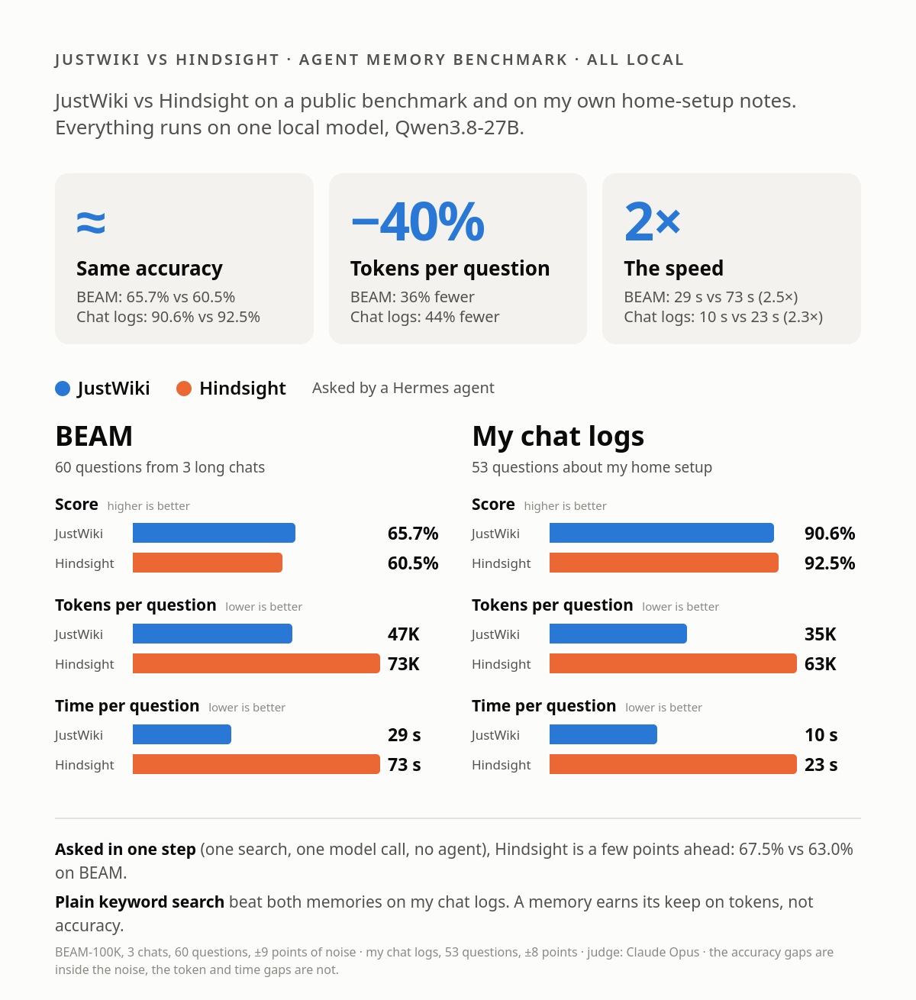

I keep my home setup's memory in a wiki that my agents read and a steward agent keeps tidy. I call the engine
**JustWiki** (the command and the repo are [`just-wiki`](https://github.com/siimtolk/just-wiki)); I described how it works in
[A shared, stewarded wiki for AI agents](https://siimtolk.github.io/articles/model-wiki/). Is JustWiki any good next to
[Hindsight](https://github.com/vectorize-io/hindsight), a purpose-built agent-memory system? I tested both on two sets of
questions, with everything built and answered on my local
[Qwen3.8-27B (QUASAR on capy-flash)](https://siimtolk.github.io/articles/new-leader-capy-quasar/): the memory systems,
the answering and the agent. Only the judge is Claude (Opus, as in the Reddit
[BEAM comparison](https://www.reddit.com/r/hermesagent/comments/1xlniyf/i_benchmarked_10_opensource_ai_memory_systems_on/)),
and Haiku answers the one baseline that puts the whole BEAM chat in the prompt.

**In short: when a Hermes agent does the asking, my wiki matches Hindsight on accuracy and is cheaper and faster.**

- **Accuracy is a tie.** The scores in the table above differ by 5 points on BEAM (in JustWiki's favour) and 2 points
  on my chat logs (in Hindsight's favour). Both gaps are inside the noise.
- **Cost is not.** With JustWiki the agent used 36–44% fewer tokens and answered in less than half the time.
- **Asked in one step**, with one search and one model call and no agent, Hindsight is a few points ahead (67.5% against
  63.0% on BEAM). So JustWiki is the better memory for an agent, Hindsight for a single lookup.
- **Building is the other way round** on my chat logs: 181 minutes and 10.8M tokens for JustWiki against 79 minutes and
  2.3M for Hindsight. On BEAM JustWiki was faster to build (100 minutes against 235) and used twice the tokens.
- **Plain keyword search beat both memories on my chat logs**, and the agent costs five to ten times the tokens of one
  step. So a memory is not worth having for accuracy. It is worth having next to putting the whole text in the
  prompt: in one step it scores a little less but uses a fraction of the tokens (7–8K a question on BEAM against 202K).

## The two test sets

**BEAM-100K** is a set of long chats between a user and an assistant, each about 100K tokens over several sessions,
with questions in ten abilities: recalling a detail, tracking an update, ordering events, resolving a contradiction,
following an instruction given earlier, and so on. A
[Reddit post](https://www.reddit.com/r/hermesagent/comments/1xlniyf/i_benchmarked_10_opensource_ai_memory_systems_on/)
compared ten memory systems on three of the chats, and I used the same three: a budget-tracker web app, a resume that
passes applicant tracking systems, and choosing a fiction series. Together 13 sessions, about 1.6M characters and 60
questions. Opus judges each answer item by item with BEAM's rubric, as in the post. The noise is large: about ±9 points.

**My chat logs** are the 105 notes my agents wrote after our conversations about my home setup, over 11 days, replayed
night by night. The 53 questions ask for a port, a unit, a model, what changed when, and include traps where the right
answer is "I don't know". Answers are checked against the expected values. The data stays private. The noise is about
±8 points.

## The contenders and the ways of asking

- **Hindsight 1.1.0** on Qwen. It retains the text, extracts facts with its own model calls and consolidates them. Its
  recall returns the best facts within about 4,000 tokens.
- **JustWiki**: pages kept by a pipeline steward. Notes come in; code routes each one, a Qwen call writes the edit,
  code checks it, so the model only gets short calls. For long chats I gave it a generic page schema. Search works at
  the level of a section and returns the best sections' text within about 3,000 tokens.
- **Keyword search (BM25)** over the raw text, 5,000 tokens: the baseline that needs no build.
- Baselines: no memory, and the whole text in the prompt.

Each memory is asked in two ways: **Qwen, one step** (one retrieval, then one Qwen call), and **a Hermes agent** on the
same Qwen, with only the memory's tools, deciding for itself what to search and read, up to 40 turns.

## Results

| Memory | Asker | Score | Tokens / question | Time |
|---|---|---|---|---|
| **BEAM: 60 questions from 3 long chats** | | | | |
| Hindsight | one step | **67.5%** | 7K | 21 s |
| Hindsight | Hermes agent | 60.5% | 73K | 73 s |
| JustWiki | one step | 63.0% | 8K | 14 s |
| JustWiki | Hermes agent | 65.7% | 47K | 29 s |
| Keyword search | one step | 61.0% | 6K | 16 s |
| No memory | one step | 13.3% | 0.4K | 1 s |
| *Whole chat in the prompt (Haiku)* | – | *73.4%* | *202K* | *32 s* |
| **My chat logs: 53 questions** | | | | |
| Hindsight | one step | 88.7% | 5K | 6 s |
| Hindsight | Hermes agent | 92.5% | 63K | 23 s |
| JustWiki | one step | 84.9% | 6K | 4 s |
| JustWiki | Hermes agent | 90.6% | 35K | 10 s |
| Keyword search | one step | 94.3% | 11K | 6 s |
| Keyword search | Hermes agent | 96.2% | 11K | 7 s |
| No memory | one step | 11.3% | 0.2K | 1 s |
| *All notes in the prompt* | one step | *96.2%* | *66K* | *34 s* |

The Reddit comparison, with Haiku in every role, had Hindsight at 67.8% and keyword search at 55.3%. So Hindsight on a
local model loses nothing, and, surprisingly, my keyword baseline is stronger than theirs.

What the table says:

- **Only big gaps mean something:** any memory against none, and the whole chat against the memories.
- **Neither memory is much better than searching the text.** On BEAM keyword search is 2–7 points behind. On my chat
  logs it is ahead of both, and as good as reading all 48K tokens of notes: they are short, specific and about named
  things, which is the case where a plain search is hard to beat.
- **The agent buys little accuracy:** on BEAM Hindsight loses 7 points and JustWiki gains 3, on my chat logs both gain
  2 to 6, at five to ten times the tokens of one step.

### Hindsight against JustWiki

|  | Hindsight | JustWiki |
|---|---|---|
| Build, BEAM | 235 min, 8.4M tokens | 100 min, 17.6M tokens (notes 16.8M, merge 0.8M) |
| Build, my chat logs | 79 min, 2.3M tokens | 181 min, 10.8M tokens |
| **Agent tokens per question** (BEAM / chat logs) | 73K / 63K | **47K / 35K** (−36% / −44%) |
| **Agent time per question** (BEAM / chat logs) | 73 s / 23 s | **29 s / 10 s** (−60% / −57%) |
| What the memory is | extracted facts with dates | pages a person can read, edit and correct |

Hindsight is a few points ahead when asked in one step and cheaper to build on short notes. JustWiki is the better memory
for an agent: 36–44% fewer tokens, more than twice as fast, an equal score. And it is the only one of the two where I can
open a page and see why it answers what it answers. Its pages are plain text, I can follow them in the wiki's web UI with
each page's history and every change the steward made, and when an answer is wrong I can open the page, see why, and fix it.

### Where each is better

BEAM, score by ability (%), 4–8 questions per column, so roughly ±15 points of noise. Best of the four memory scores in
bold.

| Ability | Hindsight, one step / agent | JustWiki, one step / agent | Keyword, one step |
|---|---|---|---|
| Abstain (say "not in the chat") | 67 / 50 | **92** / 75 | 58 |
| Contradiction | 62 / 52 | 60 / **71** | 40 |
| Event order | **53** / 50 | 47 / 49 | 46 |
| Information extraction | 65 / **76** | 65 / 65 | 67 |
| Instruction following | **79** / 62 | 75 / **79** | 71 |
| Knowledge update | **67** / **67** | 50 / 50 | 67 |
| Multi-session reasoning | **56** / 49 | 44 / 48 | 69 |
| Preference | 88 / 67 | 88 / **96** | 92 |
| Summarisation | 54 / **64** | 43 / 58 | 40 |
| Temporal reasoning | **83** / 67 | 67 / 67 | 67 |

My chat logs, score by kind of question (%), 5–12 questions per kind:

| Kind | Hindsight, one step / agent | JustWiki, one step / agent |
|---|---|---|
| Fact (a value) | 60 / **80** | 70 / 70 |
| Decision | 90 / **100** | 70 / 80 |
| Update (what changed) | 92 / **100** | 92 / **100** |
| Abstain ("not in the notes") | **100** / 60 | 80 / **100** |
| Operations, correction, multi-hop, temporal | 100 / 100 | 100 / 100 |

**Hindsight is strongest where the answer is a dated fact:** temporal questions (83% in one step, the best of all),
knowledge updates and event ordering. Its weakness is saying "I don't know". Recall always returns something, and the
answerer builds an answer from it; in the agent run on my chat logs it answered 2 of 5 unanswerable questions.

**JustWiki is strongest at knowing what it does not have, and at the overall picture.** Abstention is 92% in one step
on BEAM and 100% for the agent on my chat logs. Contradictions (71%), preferences (96%) and instruction following (79%)
are the best of the table once the agent reads sections. It is weakest where the answer is spread over several sessions:
multi-session reasoning is 44–48%, against 56% for Hindsight and 69% for keyword search, and knowledge updates are 50%.
Some updates never reached the pages at all: the user's reading goal changed from 10 to 12 books, the note writer kept
only the 10, and no steward could fix that. A wiki that merges by topic should be best at counts and lists across
sessions, so the next thing to measure is whether a missing fact is lost in the notes, in the merge or in the search.

**Keyword search is best at multi-session reasoning (69%) and worst at contradictions (40%) and summaries (40%).** It
returns raw text from every session, so counts and lists are there; deciding that two statements conflict is not
something a text match does. That is what the steward is for, and it shows: contradictions are 60–71% for JustWiki.

## The Hermes agent: why it costs so much

On paper an agent should help: it can refine its query, read more, combine sources. I read the sessions of the first
runs, which Hermes keeps in its own database.

**How a run looks.** The agent gets the question with a short instruction and the memory's tools through Hermes' MCP
layer. It usually does not see the tools up front: it finds them with a `tool_search`, reads a schema with
`tool_describe`, and calls them through a generic `tool_call` that takes a list of calls. The median session made 7
tool calls and the longest 24. Take the question "how many days between the end of my first sprint and the deadline for
the sprint-2 analytics features?", on Hindsight:

1. The agent sends two `recall` calls in one batch. The results are large, so Hermes saves them to a file and returns
   a note that says where.
2. The model tries to read the file with a code tool. The container has none, and both attempts fail.
3. It recalls again, twice, then calls `search_knowledge_base` with two arguments the tool does not take: rejected.
4. One more recall, and it answers "19 days, from March 31 to April 19".

The one-step call, handed the recall in full, answered "21 days, from March 29": the original end date, which the
rubric wanted. The memory held both dates; the agent picked the later one.

**What went wrong across all 60 sessions** (the Hindsight agent's first run; the wiki agent's latest, after the changes
described below):

| | Hindsight agent | Wiki agent (current) |
|---|---|---|
| Sessions with at least one failed tool call | 33 of 60 | 9 of 60 |
| Most common failure | 34× tried to read a saved recall result with a tool the container does not have | 9× a batch of calls that was not valid JSON (1× a search without its query) |
| Tool results, median / 90th percentile | 2.5K / 32K characters | 6.6K / 14K characters |
| Median input tokens per question | 56K | 34K |

A failed call costs a turn, and every turn re-sends the whole conversation, which is where 66–73K tokens a question came
from in the first runs. The agent also writes shorter answers (1,600 characters with Hindsight against 2,400 for one
step), and the judge scores rubric items. The deeper reasons, from the questions it lost:

- **It stops at the first relevant answer.** On a contradiction question it answered "No", where the one-step call saw
  both statements and reported the conflict.
- **It searches narrowly.** It writes its own short queries, where one step retrieves for the user's whole question.
- **It wins only where whole pages help**, such as summaries.
- **The test also rewards giving up early.** On a "not found" question the right answer is "I don't know". One step
  searches once and stops, and says so more often than the agent: 67% against 50% with Hindsight and 92% against 75%
  with JustWiki on BEAM, 100% against 60% with Hindsight on my chat logs. The agent keeps searching until it finds
  something close and builds an answer from it.

The failing calls come from Hermes' MCP layer and a container without file tools. That is the Hermes I really run, so I
am not excusing it. I fixed what I control, the wiki's tools, and left the Hindsight agent alone: its biggest failure
needs a file tool in the container.

## What I changed in JustWiki for the agent

Reading the wiki agent's sessions turned up more than failing calls, and each finding became a change:

- **Every result arrived twice.** Each tool answered with its text and again as a structured copy, and Hermes put both in
  front of the model. Fix: text-only tool results. This alone was a large part of the agent's tokens, and I only found
  it by reading the sessions.
- **The model guessed argument names.** `read_page` takes `page`; the model sent `id` in a quarter of its calls (copied
  from another tool's description), and fixing the description did nothing. Fix: `read_page` accepts `id`, `page_id`
  and `name` too.
- **`search_text` filled its budget every time**, about 32,000 characters whatever the question. Fix: a focused default
  of about 3,000 tokens: only sections that match at least a quarter as well as the best, at least three, no repeats.
- **The agent read whole pages.** Fix: `read_page` on a page over 6,000 characters returns its section list and first
  section, and the agent is asked to read one section.
- **Changes and contradictions live in a section the question's words do not match.** Fix: `search_text` also returns
  the "Disagreements & open questions" section of every page it draws on.
- **Nothing told the agent to start with the cheapest tool**, so it began with `search` (page names only). Fix: no
  `get_index` for the asker (the brief already holds the index) and a prompt that says to start with `search_text`,
  search once more with the other side's words for changes, updates, contradictions, order and counts, and then answer
  completely: every item with its date, each part of the question, and a note when the memories disagree.

I made these in two rounds, and the table shows both. "Lean" is the first four fixes; "Current" adds the disagreements
section and the second-search and complete-answer prompt.

| Hermes agent on the same wikis | First version | Lean | Current |
|---|---|---|---|
| Score | 63.0% | 60.7% | **65.7%** |
| Tokens per question | 66K | 43K | 47K |
| Median time | 35 s | 26 s | 29 s |
| Tool calls per question | 8.3 | 4.5 | 5.1 |
| Sessions with a failed tool call | 39 of 60 | 12 of 60 | **9 of 60** |

The lean version was a third cheaper but lost points on contradictions, preferences and updates: answers that missed the
section where a change is recorded, and answers that were too short. The second round brought them back (contradictions
54 → 71, preferences 75 → 96). The same changes on my chat logs took the wiki agent from 88.7% to 90.6% and from 54K to
35K tokens a question.

One run of 60 questions cannot tell 63 from 66: the same agent scored 64.2% and 65.7% in two runs of the final setup
(the first shared the GPU with another job, so I quote the second). The honest reading is that the agent got cheaper by
about a third without losing accuracy, not that it got more accurate. It still costs five to six times the tokens of one
step.

**What I tried and did not work: contradictions.** A different steward that kept both statements side by side when two
notes disagreed, and updated every page that stated the old value, scored 59.3% in one step and 61.7% with the agent,
slightly under the first version and with no gain on contradictions. The prompt change did not make the answerer see the
conflict.

## What I take from it

- On a long chat, a purpose-built memory and the wiki are about equal, and both are only a little better than keyword
  search over the text. On short, specific notes a plain search wins. A memory earns its keep on tokens: 7–8K a
  question against 202K with the whole chat in the prompt.
- Hindsight is the better one-step memory, especially for dates and updates. JustWiki is better at saying "not in my
  memory", better at contradictions and preferences, and it is the one an agent reads cheaply.
- The agent gave no real gain in accuracy. For a fixed question set the one-step call is the better deal; the agent is
  for questions you cannot phrase in advance.
- Check tool results and argument names in any MCP server an agent reads.
- The notes decide the wiki. Writing them is 95% of its build tokens, and a change the note writer drops cannot be
  recovered by any steward.
- The benchmark found real bugs in my steward, not only scores. Pages that kept outgrowing the size limit were split
  again and again, and every move left its "Moved here from" marker, so some pages carried four or seven in a row
  (fixed: markers no longer travel with moved text). Decision notes that answer an open question that does not exist in
  the replayed wiki waited in the inbox for ever and stopped the build (fixed: they merge like any other note). Nothing
  in a normal day of use would have shown either.
